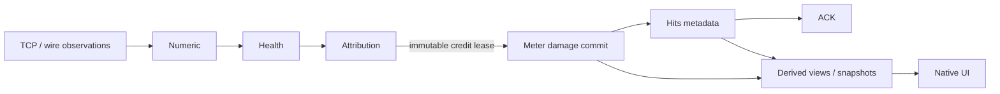

# Rust code guide

Release **0.2.6 / Windows 0.2.6.0 / capture ABI 2** adds compact encounter recordings
and recorded-session replay. Damage results match published 0.2.5 on the ten
currently available inputs; the earlier 17-input release comparison remains
historical evidence for 0.2.3 through 0.2.5. Hits uses bounded
post-commit count metadata. Actor-wide explicit/self exclusion is absent; UI and
logging improvements from 0.2.4 remain. Read [the handoff](../AGENTS.md) for current
validation evidence, cleanup policy and scoped publication authority.

Read the [attribution contract](../docs/uniform-attribution-spec.md) before
changing combat interpretation. The [root README](../README.md) covers use,
build prerequisites and capture research tooling.

## Data flow and ownership



Hit metadata runs after successful commit. Missing count evidence uses a count
fallback; it cannot reject damage, reselect an actor, delay a lease or prevent ACK.


| Module | Owns |
| --- | --- |
| `core/src/transport.rs`, `protocol.rs`, `hp_wire.rs` | Reassembly, framing and bounded wire grammar |
| `core/src/damage_wire.rs`, `hp_evidence.rs` | Field retention, acknowledgment counters and diagnostic previews |
| `core/src/numeric.rs` | Canonical same-object finite HP comparisons |
| `core/src/identity.rs`, `identity/ownership.rs` | Actor incarnations, identity evidence, ownership and shared damage-side eligibility |
| `core/src/health.rs` | Target-local packet association, explicit/HP reconciliation and clean-anchor admission |
| `core/src/combat.rs` | Existing action/state/skill evidence, partial clocks and diagnostic impact model |
| `core/src/attribution.rs` | Sole allocation/fallback, recent attack spans, unattributed causes and acknowledged delivery |
| `core/src/hit_count.rs` | Bounded post-commit display counts, explicit overlap and duplicate-delivery suppression; no damage decisions |
| `core/src/meter.rs` | Atomic actor amounts and downstream encounter, target, owner and skill views |
| `core/src/replay.rs`, `session.rs` | Production orchestration, retries, file replay and measurement boundaries |
| `app/src` | Win32 UI, capture ownership, authenticated worker IPC and raw recording |
| `app/src/diagnostics.rs` | Flushed JSONL application/error logs beside recordings; status stays outside the meter UI |
| `app/src/research_window.rs`, `research.rs` | Native research epoch controls and shared raw recorder; no combat interpretation |
| `capture/src` | Packet Monitor capture library and stable ABI |

All actors follow the same packet interpretation path. Explicit impact is matched
per event; a source with explicit records remains eligible for other inferred
damage. Names, main selection and owner grouping cannot choose packet eligibility.
Legacy `Health` returned allocations are compatibility previews; production delivery
consumes only the
persistent Attribution outbox.

## Hits fields and compatibility

The table's **Hits** and the encounter summary use `Snapshot.display_hits` and
`Row.display_hits`. They show one plain best number with no uncertainty markers.
The audit JSON `hits` fields retain the old explicit-credit counts; `display_hits`
contains the UI number. `capture_totals.explicit_hits` is unchanged, and
`estimated_allocations` counts damage-credit deliveries rather than physical hits.
Do not substitute either legacy counter for the new UI count. Crit still divides
observed explicit flags by explicit hits, even when displayed Hits is higher.

`HitAssignment` retains the count alongside existing membership. Updates follow
late joins and target/owner/archive views without republishing damage. The bounded
counter deduplicates supported attack frames, explicit overlap and fallback
source/target HP obligations. A late explicit counterpart can replace an earlier
inferred contribution. Raw parsing, weights, eligibility and damage receipts are
unchanged; packet-to-physical-hit multiplicity is not asserted to be universal.

## Rules to preserve

- Apply the shared no-friendly-fire predicate before explicit attribution,
  inferred allocation, reconciliation, training, fallback, retry and publication.
  Registry proof overrides bounded role-cache loss. Generic NPC/owned-entity
  labels do not establish faction; ownership conflicts revoke derived side proof.
- Only actual attack or eligible finite explicit packets establish activity.
  Target-specific activity history uses `Meter.idle_ns`, the editable idle
  split setting. The remake retains eligible-active-attacker HP fallback; missing
  presentation records and ambiguous hit amounts are not extra rejection rules.
  Appearance/name/HP/presence cannot refresh it. There is no
  separate hot/warm multiplier or activity timeout.
- Preserve true finite HP changes across transport gaps with uncertainty.
  Duplicate parallel observations are nonadditive; a canonical Initial cannot
  borrow a stale association-cache baseline. MAX never enters arithmetic.
- Keep raw explicit amount separate from HP-effective impact. Conflicting source
  claims retain diagnostics but cannot subtract HP overlap or train the model.
  Estimated allocations are never training truth.
- Empty eligible support is a counted unattributed outcome. It cannot be settled
  later by a newly visible bystander. Distinguish missing activity, side conflicts
  and delivery-capacity failures.
- Lease an immutable credit and freeze its prepared skill. Commit Meter before
  ACK. An identical receipt retry is idempotent. Arithmetic rejection retains the
  lease; capacity reselection still passes the sole eligibility/fallback path.
  Reset drains both queued credits and known-source delivery debt before changing
  measurement membership. Ability refinement never republishes actor damage.

Accounting must conserve both explicit and inferred origins:

```text
detected obligations = published + queued + known-source owed + unattributed
detected HP loss = matched eligible explicit impact + inferred + unattributed HP
```

These equations establish accounting consistency, not correct physical actor
assignment or complete packet decoding.

## Bounded storage and work

Numeric retains 1,024 baselines. Health caps slots and pending budgets at 1,024,
facts at 4,096, per-target budgets/facts at 64/128, and orphan claims at 256.
Attribution caps side records at 512 and activity relationships, outbox rows and
known-source delivery rows at 1,024 each. The hit counter retains at most 1,024
seen-observation rows and 1,024 fallback keys. Audit, model, clock, skill and temporary
storage have additional fixed caps. Recording and downstream meter aggregates
are independent; no disk index or spill extends the assignment working set.

The current conservative inference ceiling is **9,876,536 bytes**, including the
**204,880-byte** hit counter, below 10 MiB. It excludes raw recording, transport/
identity diagnostics and downstream meter aggregates. The dedicated pressure test measures
allocator-requested bytes including temporary allocations; this is not process
RSS. Current measurements are recorded in the handoff. Run
`credit_bounds` and `causal_memory` when changing state layout or capacities.

For per-target pending budgets P and facts F, one association resolution costs
O(PF + F² + F log F); resolving all budgets can cost O(P²F + PF²).
Deadline expiry is indexed. Activity lookup and fallback sort bounded support.
Registry-revision validation and publication have explicit bounded work sets.
Measure mass expiry separately from ordinary per-input service and UI latency.

## Numerical regression checks

Use the published v0.2.3/v0.2.4 meter hashes and source tags in AGENTS.md as frozen
baselines. Historical acceptance filenames were removed by cleanup. Redownload a
release asset into a new ignored folder and verify its checksum before comparing;
rebuilding current source does not recreate a released baseline artifact. Archived
local validation scripts may require their old binary paths to be supplied again;
they are evidence of the recorded run, not proof that cleaned files still exist.

The release check covered nine completed research sessions, seven live files and
world snapshot. One live file ended with a capture-pipe error: compare all retained
bytes and disclose the missing tail. Inventory inputs for each new check instead of
assuming the old 17-file manifest covers later recordings. Do not recover or count
the ten intentionally pruned historical files as current replay inputs.

Compare complete explicit-prefix, HP-observation and interval/allocation streams,
plus application audits by source, target, encounter, skill and origin. Preserve
raw amounts, effective HP, flags and unattributed causes. Equal totals alone do not
establish equivalence. The known 0.2.3-to-0.2.5 audit differences allowed by the
release check are only `display_hits`, the separate hit-count resource fields
(subtract their ceiling from the combined bound), and actor-label formatting.
Retain old `hits` and all damage-bearing fields in the comparison. See the local
verification paths in AGENTS.md for scripts, exact manifests and fingerprints.

## Build and verification

### Encounter recordings (0.2.6)

The meter's old recording format is not an acceptance compatibility constraint.
Package revision is 0.2.6, Windows resources 0.2.6.0, capture ABI still 2.
The accepted research recorder remains unchanged: its existing JSONL, event
journal and metadata still work. Meter builds use a new `.mrec` format, sharing
one `context.mrec` per session folder and writing small encounter entries named
`YYYY-MM-DD_HH-mm-ss.mmm_SCENARIO_encounter-NNNN.mrec`. Both the session folder and
encounter names use Windows local OS time; absolute Unix times remain in metadata.
An observed internal scenario prefix supplies a best-effort label, with room
suffixes removed. Missing evidence yields `unknown-instance`. Scenario annotations
are recording-side hints, independent of combat eligibility and encounter rules.

Raw TCP bytes, both directions, unknown application messages, sequence numbers,
flags, timestamps and ownership epochs are retained before game parsing. The
journal also retains the initial cache/settings and source-content fingerprint,
ownership changes, commands/results, capture watermarks, loss reports, decoder
failure and completion. Encounter entries retain the originally observed explicit/
estimated totals; the shared stream also retains the last selected UI snapshot.
A paused semantic decoder cannot suppress later raw input.
There is no new original-link-layer recording or change to capture filtering.

`replay ENCOUNTER.mrec` resolves the sibling context, reconstructs the session
controls and selects the requested encounter. Keep the whole session folder.
Entries evicted by the meter's existing 32-encounter bound replay the recorded
prefix at their last retained view; the audit identifies `recorded_encounter_prefix`.
This does not claim that a historical view includes later data or that live and
offline wall-clock scheduling are identical. Loading `context.mrec` reconstructs
the complete retained session. Parser changes can cause command-result divergence,
which remains visible in diagnostics instead of being silently ignored.

```powershell
mabi-meter recording inspect ENCOUNTER.mrec
mabi-meter recording dump ENCOUNTER.mrec
mabi-meter recording export ENCOUNTER.mrec NEW_DIRECTORY
mabi-meter recording pack OLD_RAW.jsonl NEW.mrec
```

Inspect, dump and export do not use the combat parser. Dump streams raw records
and journal events as JSONL to stdout (counts go to stderr). Export writes the established
research folder layout, retaining all preceding/shared raw traffic. The selected
encounter is metadata, not an opcode-filtered or self-contained traffic slice.
`pack` converts a legacy TCP log into a new file without changing its source;
its completion means conversion finished, not proof the original capture was
complete. Extra legacy row fields remain evidence events. Existing raw research
collectors using `capture_file::read` can read `.mrec` traffic; they deliberately
do not apply recorded UI commands or timer events. Automatic giant audit dumps
are no longer written by the meter; regenerate them with `replay --audit`.

The binary stream starts with `MABIREC` and version byte 1. Each block has a
32-byte little-endian header: `BLK1`, sequence u64, decoded length u32, stored
length u32, codec u32 (0=plain, 1=Brotli), stored-body CRC32, header CRC32 (bytes
4..28). Blocks target 256 KiB before compression and cap at 17 MiB, independently
of the inference-memory ceiling. Records use a tag u8 and body length u32: tag 1
is binary TCP/ownership data, tag 2 is an unchanged UTF-8 JSON event, and tag 3
is a capture-watermark u64. TCP fields are ownership epoch u64, timestamp u64,
sequence u32, source/destination ports u16, SYN/FIN/RST/ACK bits 0..3, two
length-prefixed UTF-8 endpoints (u16 byte lengths), then the unmodified payload.
Identical observations remain distinct records. Encounter entries start with
`MABIENC` and version 1, JSON length u32, JSON CRC32 and a bounded JSON reference
to the fixed sibling `context.mrec`. No directory traversal or reference chains.

The writer flushes independent blocks at UI publication (normally 200 ms), syncs
startup/completion, and reports a missing finish or truncated final block as
incomplete. A truncated block contributes no partial records; previous complete
blocks remain readable. Bad checksums/versions/lengths fail explicitly. Flush
is not a guarantee against power loss. Raw capture and its original timestamps
remain the authority; the stream is not parsed damage or proof of physical truth.

0.2.6 validation: 335 private-inclusive Rust tests, 22 focused native Windows
tests, 24 Python tests, both actual synthetic UI smoke paths, resources/version,
demo and no-capture system check. The nine retained research sessions and world
snapshot pass raw TCP roundtrip and full-audit equality with the published 0.2.5
EXE, without ignored fields. These ten raw inputs compress from 376,071,100 to
35,916,346 bytes (90.45%); future live journals add session-dependent overhead.
Seven older top-level meter inputs vanished during validation, so they are not
part of this rerun. The historical 17-input release validations remain historical
evidence. Local results: `.local/recording-20261109/`.

From the repository root:

```powershell
./scripts/build-rust.ps1
# If the standard EXE is running, build a separate acceptance candidate:
./scripts/build-rust.ps1 -OutputName mabi-meter-next.exe
./scripts/test-rust.ps1
./scripts/test-rust.ps1 -LocalFixtures
New-Item -ItemType Directory -Force .local | Out-Null
./dist/mabi-meter.exe --version
./dist/mabi-meter.exe --check-system
./dist/mabi-meter.exe demo
./dist/mabi-meter.exe --ui-smoke .local/ui-smoke.json
./dist/mabi-meter.exe replay capture.jsonl --audit .local/replay-audit.json
./scripts/build-research.ps1 -UseDocker
./dist/mabi-research.exe --research-ui-smoke .local/research-ui-smoke.json
```

Build/test commands use the locked offline dependencies after the explicit
Fetch step documented in the root README. Add `-UseDocker` for the GNU cross
build. `-LocalFixtures` requires private files under `.local/test-fixtures`;
ordinary synthetic tests do not. Audit and UI smoke output paths must be new.
System check, demo and UI smoke do not start live capture. Replay exit code 2
means partial coverage, not necessarily a decoder failure.

The distributed research tool is still v0.2.3; meter releases 0.2.4/0.2.5/0.2.6 contain
only the meter and checksums. Rebuilding research from this tree stamps the current
package version, and does not reproduce the historical asset byte for byte.

The research build enables `research-ui` to open native epoch controls by
default. Only `dist/mabi-research.exe` is replaced; the validated meter stays
in place. This EXE can be copied alone to another Windows PC with no Python,
Tk or separate capture DLL. The native and legacy stdin controls share one raw
recording session implementation. The research UI smoke uses synthetic commands
and the actual recorder, checks Unicode labels/notes and close/save, and never
starts the elevated worker. See the root README for cross-player collection.

The optional capture DLL has its own excluded workspace/lockfile:

```powershell
cargo test --manifest-path native/capture/Cargo.toml --locked --offline
```

Useful core examples, run with `cargo run --manifest-path native/Cargo.toml
-p mabi_meter_core --locked --offline --example NAME -- ARGUMENTS`:

Direct Cargo commands require dependencies cached under their active
`CARGO_HOME`. To reuse the cache populated by the build scripts, set
`CARGO_HOME` to the absolute `.build/cargo` path and `CARGO_TARGET_DIR` to
`.build/rust` before running them.

| Example | Purpose |
| --- | --- |
| `evaluate_attribution CAPTURE` | Production replay audit |
| `evaluate_causal CAPTURE` | Streaming interval/obligation checks, bounded-storage and service measurements |
| `credit_bounds` | Conservative inference storage contract |
| `audit_damage_fields` | Complete known-prefix field diagnostics |
| `export_cross_reference CAPTURE NEW_EVENTS.jsonl\|- NEW_AUDIT.json` | Read-only packet/HP/interval export; `-` streams JSONL to stdout, summary to stderr |
| `equal_share_census` | Historical equal-share reason-label census; not current fallback coverage |

Review the example's usage before running it. Offline collectors are not fed
back into inference and are not live storage dependencies.

`scripts/audit-hit-counts.py` compares presentation-based hit-count hypotheses
against these exports without feeding any result into damage allocation. It
requires an independent baseline application audit and checks damage assignments,
skills, origins, HP accounting and unattributed causes. For a small offline run:

```powershell
./dist/mabi-meter.exe replay capture.jsonl --audit .local/baseline.json
# Run export_cross_reference with capture.jsonl .local/events.jsonl .local/observed.json
python scripts/audit-hit-counts.py --events .local/events.jsonl --audit .local/observed.json --baseline-audit .local/baseline.json --output .local/hit-counts.json
python -m unittest discover -s scripts/tests -v
```

Use new output paths. Large runs can pipe the exporter's stdout directly into
the audit's `--events -` input; event files are optional evidence outputs, never
lookup indexes. The observer retains at most 4,096 compact combat packets and
12 examples. Final audit comparison loads the bounded diagnostic reports
separately. Packet counts and identical-payload collapse remain competing
hypotheses; unknown physical multiplicity stays unknown. This is offline research
tooling; it adds no Python dependency to the meter EXE. The production Hits UI
uses a separate bounded post-commit counter. Each evidence cache retains at most
1,024 rows; its conservative ceiling is 204,880 bytes, included in the current
9,876,536-byte inference ceiling. Display counts never change damage or crit flags.
